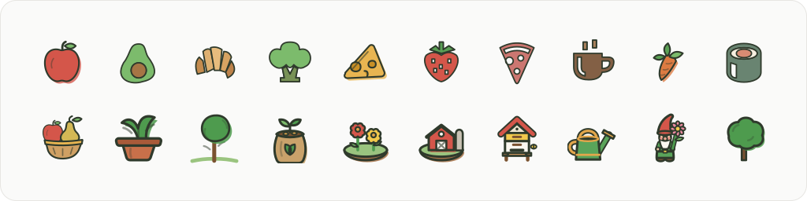

<p align="center">
  <a href="https://gabrivinaigit.github.io/ki-icons/catalog.html">
    <picture>
      <source media="(prefers-color-scheme: dark)" srcset="./.github/logo-lockup-dark.svg">
      
    </picture>
  </a>
</p>

<p align="center">
  Hand-drawn, full-colour icons. An Iconify set for Nuxt, Vue, React and more.
</p>

<p align="center">
  <a href="https://www.npmjs.com/package/ki-icons"></a>
  <a href="https://github.com/gabriVinaiGit/ki-icons/actions/workflows/test.yml"></a>
  <a href="./LICENSE"></a>
</p>

<p align="center">
  <a href="https://gabrivinaigit.github.io/ki-icons/catalog.html">Icons</a>
  ·
  <a href="#install">Install</a>
  ·
  <a href="#use-with-nuxt">Docs</a>
  ·
  <a href="./CONTRIBUTING.md">Contributing</a>
  ·
  <a href="https://github.com/gabriVinaiGit/ki-icons/issues/new?template=icon-request.yml">Request an icon</a>
</p>

## About

Hand-drawn, full-colour illustrations — food, food categories, trophies, currency
and the worlds with what goes in them —
packaged as an [Iconify](https://iconify.design) icon set with the prefix `ki`.
It works like `@iconify-json/mdi`: install it, add it to your Nuxt modules, and write
`ki:banana` wherever you would write `mdi:home`.

<a href="https://gabrivinaigit.github.io/ki-icons/catalog.html">
  
</a>

**[Browse all icons →](https://gabrivinaigit.github.io/ki-icons/catalog.html)**
Search, preview at any size, copy a ready-made snippet or download the SVG / PNG.

| Family   | Names                                          | Example              |
| -------- | ---------------------------------------------- | -------------------- |
| food     | the food itself, in English                    | `ki:banana`          |
| category | `category-` + the category                     | `ki:category-fruit`  |
| trophy   | `trophy-` + the trophy                         | `ki:trophy-sprout`   |
| currency | `currency-` + the seed, or what holds them      | `ki:currency-seed`   |
| world    | `world-` + the place, standing on its island    | `ki:world-garden`    |
| deco     | `deco-` + the object, standing on its base      | `ki:deco-bench`      |
| tree     | `tree-` + the species, standing on its base     | `ki:tree-oak`        |

The full list, grouped by family, is in `names.json`.

## Install

```sh
npm install ki-icons
# or
pnpm add ki-icons
yarn add ki-icons
bun add ki-icons
```

It is a plain npm package, so any package manager works. The examples below
use npm; swap in your own.

## Use with Nuxt

It is a Nuxt module (Nuxt ≥ 4.1). One line:

```ts
// nuxt.config.ts
export default defineNuxtConfig({
  modules: ['ki-icons'],
})
```

The module hands the collection to [`@nuxt/icon`](https://github.com/nuxt/icon)
— installing it too if the app does not list it — and ships the whole set in
the client bundle, so icons chosen at runtime (from data) work without a
server, in static and mobile builds as well. Your own `icon` config still
wins over these defaults; your other custom collections are kept.

```vue
<Icon name="ki:banana" size="48" />
```

With Vuetify, if `v-icon` renders through `<Icon>` (as it does for `mdi:`
icons in a Nuxt + `@nuxt/icon` setup), `ki:` icons follow the same rules —
`size="x-small"` … `"x-large"` and numbers give exactly the sizes an mdi icon
gets:

```vue
<v-icon icon="ki:banana" size="small" />
<v-icon icon="ki:category-fruit" size="x-large" />
<v-icon icon="ki:trophy-tree" :size="64" />
```

## Use with Vue

Register the set once with [`@iconify/vue`](https://iconify.design/docs/icon-components/vue/),
then use it like any other Iconify icon. Everything is bundled: no API calls.

```sh
npm install ki-icons @iconify/vue
```

```ts
// main.ts
import { addCollection } from '@iconify/vue'
import kiIcons from 'ki-icons/icons.json'

addCollection(kiIcons)
```

```vue
<script setup lang="ts">
import { Icon } from '@iconify/vue'
</script>

<template>
  <Icon icon="ki:banana" width="48" />
</template>
```

## Use with React

The same with [`@iconify/react`](https://iconify.design/docs/icon-components/react/):

```sh
npm install ki-icons @iconify/react
```

```tsx
import { Icon, addCollection } from '@iconify/react'
import kiIcons from 'ki-icons/icons.json'

addCollection(kiIcons)

export function Fruit() {
  return <Icon icon="ki:banana" width={48} />
}
```

## Use with React Native

Turn an icon into SVG markup with [`@iconify/utils`](https://iconify.design/docs/libraries/utils/)
and draw it with [`react-native-svg`](https://github.com/software-mansion/react-native-svg):

```sh
npm install ki-icons @iconify/utils react-native-svg
```

```tsx
import { SvgXml } from 'react-native-svg'
import { getIconData, iconToHTML, iconToSVG } from '@iconify/utils'
import kiIcons from 'ki-icons/icons.json'

export function KiIcon({ name, size = 48 }: { name: string, size?: number }) {
  const data = getIconData(kiIcons, name)
  if (!data) return null
  const { attributes, body } = iconToSVG(data, { width: size, height: size })
  return <SvgXml xml={iconToHTML(body, attributes)} />
}

// <KiIcon name="banana" />
```

## Use with Flutter, or as plain files

Every icon is a self-contained SVG with no external references. Download the
ones you need from the [catalog](https://gabrivinaigit.github.io/ki-icons/catalog.html)
(SVG or 512 px PNG) or take them from [`svg/`](./svg), then use them as assets —
in Flutter with [`flutter_svg`](https://pub.dev/packages/flutter_svg):

```dart
SvgPicture.asset('assets/icons/banana.svg', width: 48)
```

## Use anywhere else

`icons.json` is a standard `IconifyJSON` document, so any Iconify tool reads
it: `@iconify/utils`, UnoCSS
`presetIcons({ collections: { ki: () => kiIcons } })`, Tailwind's Iconify
plugins. The source SVGs are also shipped in `svg/` for direct use.

## Colours

Every icon carries its own palette — a dark outline and a soft offset shadow —
so it does **not** follow `color` / `currentColor`. Iconify renders such
icons as images rather than masks, which keeps the colours intact. Size is
the only thing the surrounding text controls.

## Contributing

Missing a food, a trophy or a place? [Request an icon](https://github.com/gabriVinaiGit/ki-icons/issues/new?template=icon-request.yml)
— or draw it yourself: [CONTRIBUTING.md](./CONTRIBUTING.md) covers the style,
the file layout and the checks. In short:

1. Draw it on a square `viewBox` (24 × 24 for food, any square for the rest),
   with its own fills and no `currentColor`.
2. Save it as `svg/<family>/<kebab-name>.svg`.
3. Run `npm run build` — it regenerates `icons.json`, `names.json`,
   `catalog.html` and the README preview, and fails on a malformed or unsafe
   file (scripts, external references, event handlers).
4. Commit the SVG together with the regenerated files: they are what
   installs read, with no build step on the consumer's side.

`npm test` runs the same checks without writing anything, and fails if
`icons.json` or `names.json` is out of step with `svg/` or the version. It runs
on every push (GitHub Actions) and before every `npm publish`.

## Versions

From 1.0 an icon's name is a promise: apps store names like `ki:deco-bench` in
their data. A new icon is a minor version; a redrawn one a patch; renaming or
removing one is a major version.

## License

MIT © Gabriele Vinai
